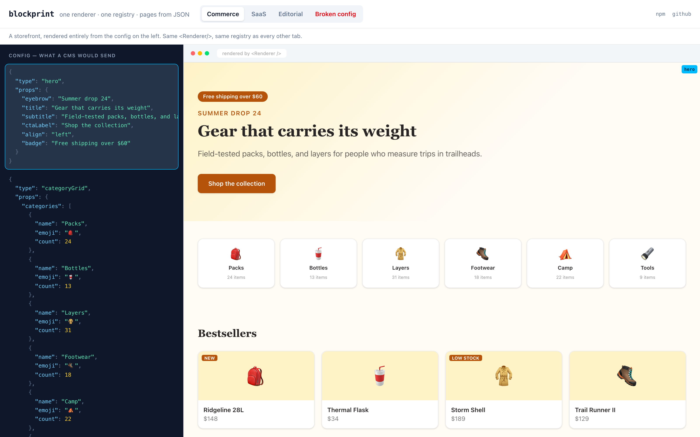
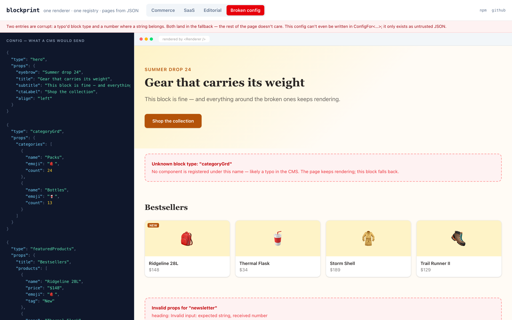

# blockprint

**Typed, config-driven block rendering for React.** Render arbitrary UI trees from CMS-controlled JSON — with compile-time safety between your components and the config, and runtime validation at the boundary.

**Live demo: [blockprint.terzidest.com](https://blockprint.terzidest.com)** — three completely different pages (commerce, SaaS, editorial) from one renderer and one registry, plus a deliberately broken config showing graceful fallback. Hover a config entry to highlight the block it renders.

```sh
npm install blockprint
```

[](https://blockprint.terzidest.com)

## The problem

Content teams compose pages from a fixed set of block types without touching code. Consuming those configs in React usually collapses into a `switch` statement on `block.type` — every possible block imported into every page, `props` typed as `any`, unknown types crashing or silently vanishing.

blockprint inverts that: **you** define the blocks and their prop types, register them once, and render any config — including configs containing block types you've never seen.

## Usage

```tsx
import { createRegistry, Renderer } from "blockprint";
import { z } from "zod";

const HeroBanner = ({ title, subtitle }: { title: string; subtitle?: string }) => (
  <header><h1>{title}</h1>{subtitle && <p>{subtitle}</p>}</header>
);

const registry = createRegistry({
  hero: HeroBanner,                                   // compile-time trust
  gameGrid: {                                         // runtime guarantee
    component: GameGrid,
    schema: z.object({ games: z.array(gameSchema) }),
  },
});

// config typically arrives from a CMS at runtime
<Renderer config={pageConfig} registry={registry} />;
```

- A registered component whose props don't match its schema is a **compile error on that key**, not a runtime crash.
- Unknown block types and schema-rejected props render a configurable **fallback** — a page never crashes because the CMS shipped something unexpected.
- Configs authored in TypeScript (not fetched) get full autocomplete via `ConfigFor<typeof registry>`.

## The guarantee, visible

Register a component whose props don't match its schema, and the error lands **on that block**, in plain language — not three levels deep in generic-inference soup:

```ts
const Grid = (props: { items: string[] }) => …;

createRegistry({
  grid: {
    component: Grid,
    schema: z.object({ wrong: z.string() }), // ⟵ error HERE:
    // Type 'ZodObject<{ wrong: ZodString }, $strip>' is not assignable to type
    //   '"schema output is not assignable to props of 'grid'"'
  },
});
```

And when bad data arrives at **runtime** instead — an unregistered block type, a number where a string belongs — the page renders everything else and routes the broken entries to your fallback:

[](https://blockprint.terzidest.com)

## Design principles

- **Framework-agnostic**: React only. No Next.js/Remix imports anywhere in the library. The demo happens to be Next.js.
- **Validator-agnostic**: schemas are typed against [Standard Schema](https://standardschema.dev), so zod, valibot, and arktype all work. blockprint has **zero runtime dependencies**.
- **The library ships the mechanism, not the content**: no blocks, no data fetching, no styling opinions.

See [DESIGN.md](./DESIGN.md) for the full design document.

## Gotchas

- **`exactOptionalPropertyTypes` + zod's `.optional()`**: with that compiler flag enabled, a schema field like `z.string().optional()` produces `prop?: string | undefined`, which is not assignable to a component prop declared `prop?: string` — so the registry's compile-time check (correctly) rejects the registration. Either declare such component props as `prop?: string | undefined`, or leave the flag off in the app consuming blockprint. This is the zod/flag interaction, not a blockprint rule, but blockprint's registry check is where you'll meet it.
- **Deployed fallbacks**: the default fallback renders a warning box in development and `null` in production. A public demo or production page that wants *visible* failure must pass its own `fallback` component.

## Repository layout

```
packages/
  blockprint/   the library
  demo/         a Next.js consumer proving the tool works
```

## Development

```sh
pnpm install
pnpm test        # runtime + type-level tests
pnpm typecheck
pnpm dev         # demo at localhost:3000
```
